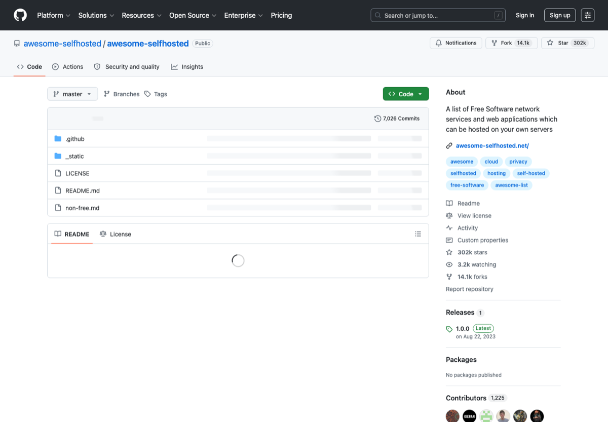

# 中文自托管与 NAS 工具清单

> 家庭服务器、NAS、个人云、相册、媒体库、密码库和监控工具整理。

## Overview

整理自托管入口、Docker 管理、相册、影音、网盘、密码库、Git 服务和监控工具。

本仓库只保留与主题直接相关、入口稳定、说明清晰的资源。优先收录官方文档、主流开源仓库、长期可访问的产品页面和常用工具链。

## Key Resources

awesome-selfhosted / Docker / CasaOS / Immich

## Resources

| Resource | Use case |
| --- | --- |
| [awesome-selfhosted](https://github.com/awesome-selfhosted/awesome-selfhosted) | 自托管项目大列表。 |
| [Docker](https://www.docker.com/) | 容器基础设施。 |
| [CasaOS](https://casaos.io/) | 家庭云系统。 |
| [Immich](https://github.com/immich-app/immich) | 自托管相册。 |
| [Jellyfin](https://jellyfin.org/) | 自托管媒体服务器。 |
| [Nextcloud](https://nextcloud.com/) | 个人云盘和协作平台。 |
| [Vaultwarden](https://github.com/dani-garcia/vaultwarden) | 轻量 Bitwarden 兼容服务。 |
| [Uptime Kuma](https://github.com/louislam/uptime-kuma) | 自托管监控面板。 |

## Recommended Path

1. 先用 Docker Compose 管理服务。
2. 所有外网暴露服务都要有 HTTPS 和强密码。
3. 先搭备份，再搭相册和网盘。

## Notes

- 避免将管理面板直接暴露到公网。
- 家庭 NAS 的核心风险是缺少可靠备份，而不是部署失败。

## Screenshot

Source: [https://github.com/awesome-selfhosted/awesome-selfhosted](https://github.com/awesome-selfhosted/awesome-selfhosted)

## Data

Structured resource data is available in [`data/links.json`](data/links.json).

## Contributing

PRs are welcome for official links, documentation updates, screenshot refreshes, and concise use-case descriptions. Please avoid mirrors, cracked software, referral links, and unverified downloads.

## License

MIT. Third-party trademarks, screenshots, and website content belong to their respective owners.
